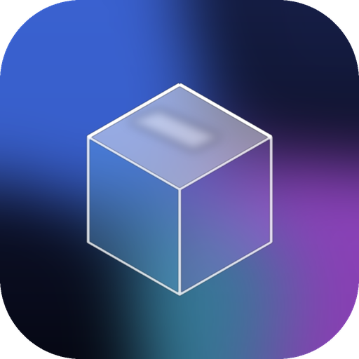
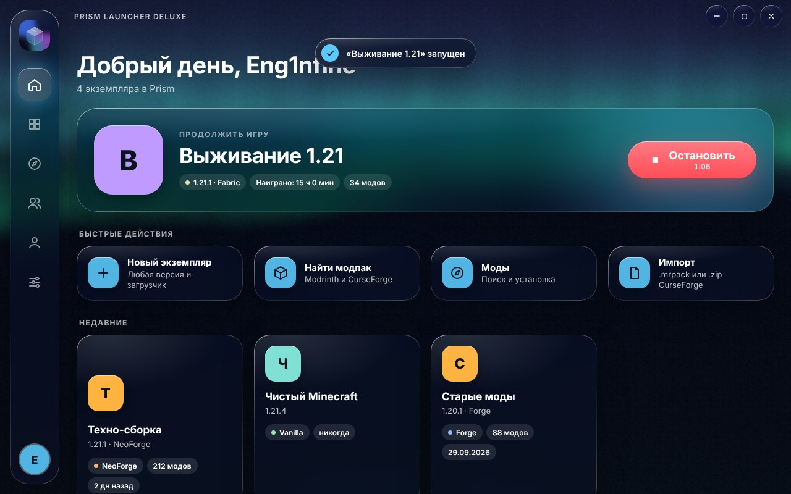
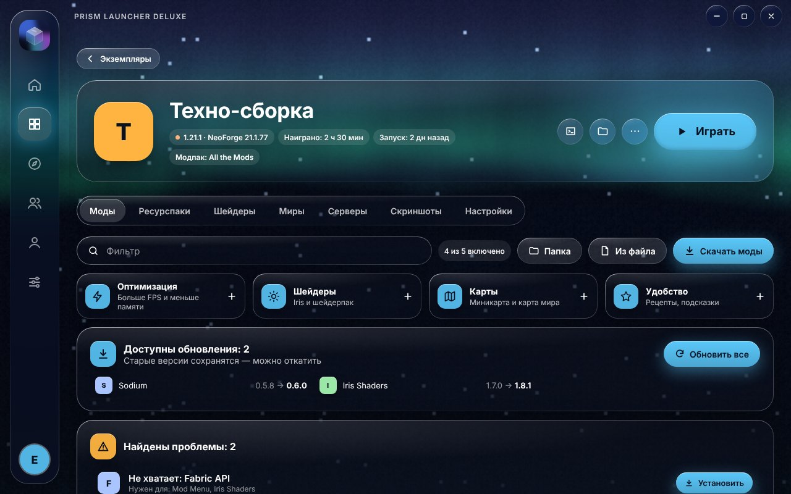
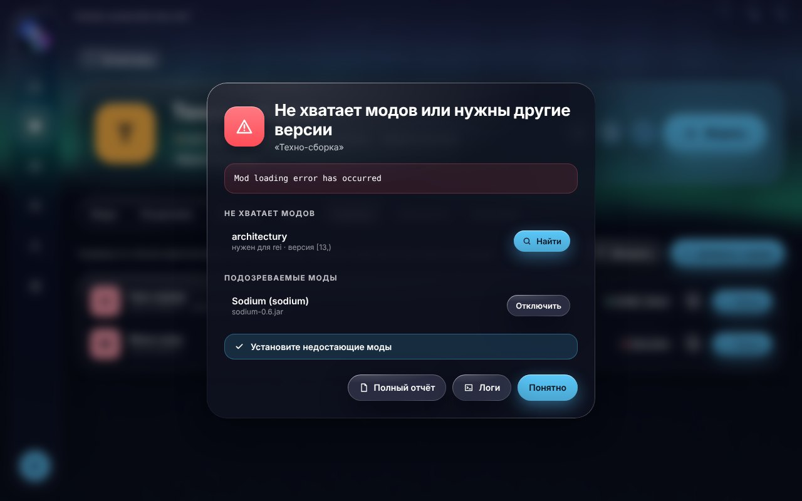
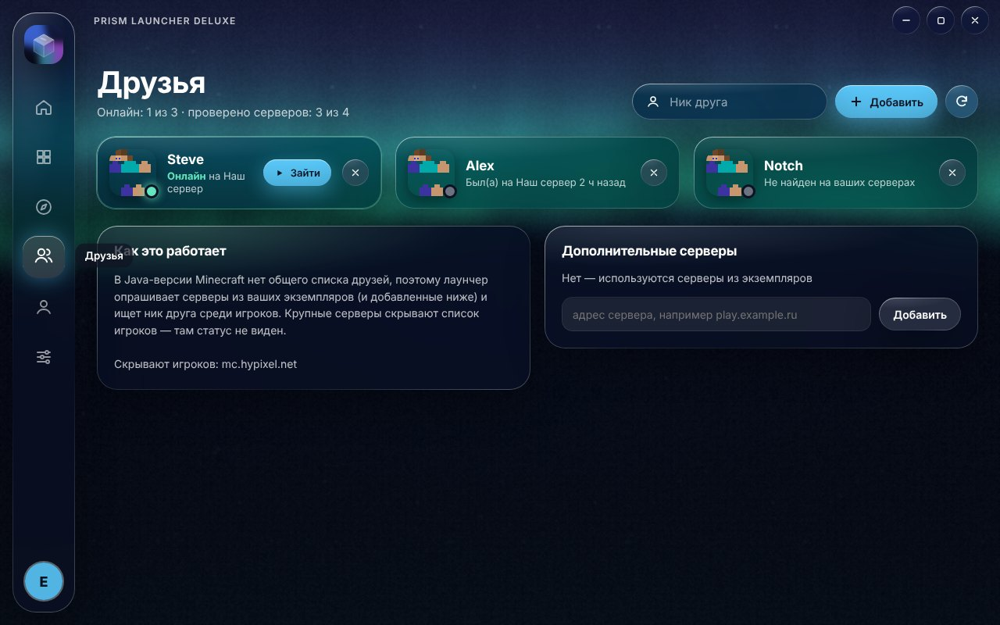
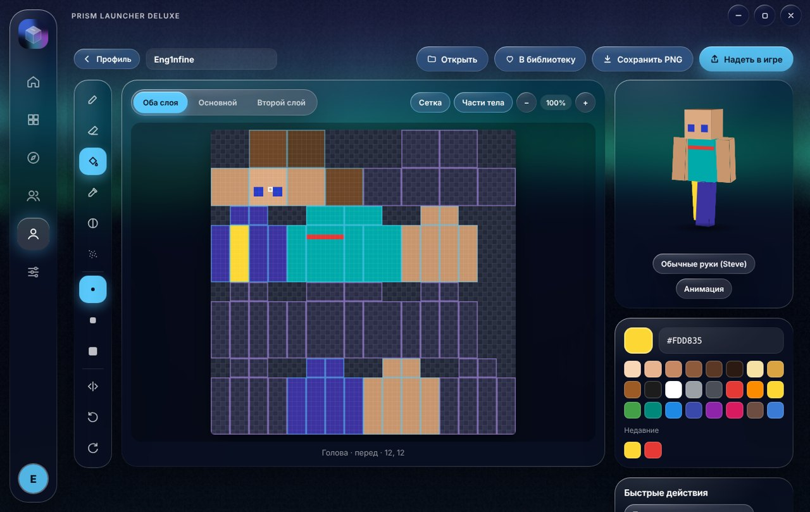
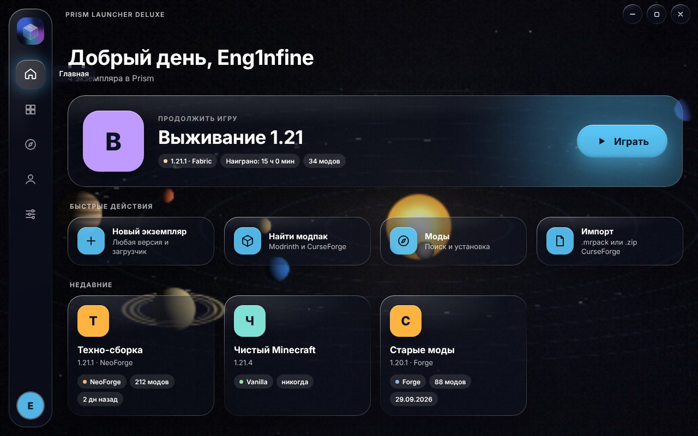
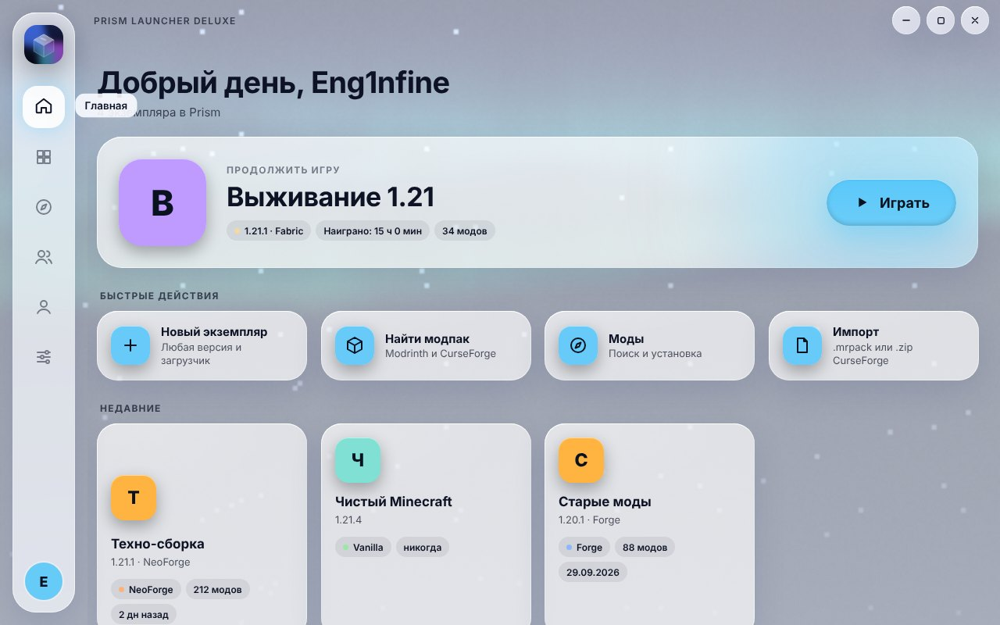

<div align="center">



# Prism Launcher Deluxe

**Красивая оболочка в стиле Liquid Glass для Prism Launcher**

Экземпляры, моды, модпаки, друзья, скины — в одном стеклянном окне с живыми анимированными фонами.

[**Скачать**](../../archive/refs/heads/main.zip) · Windows 10 / 11 · macOS · бесплатно

</div>

> ⚠️ **Неофициальный проект.** Не связан с Mojang Studios, Microsoft или командой Prism Launcher.
> Minecraft — товарный знак Mojang Studios. Для игры нужна лицензионная копия Minecraft: вход в аккаунт Microsoft и запуск игры выполняет установленный [Prism Launcher](https://prismlauncher.org).



## Возможности

**Экземпляры**
- Общие с Prism Launcher: всё, что создано здесь, видно и там
- Создание с любой версией Minecraft и загрузчиком: Vanilla, Fabric, Quilt, Forge, NeoForge
- Обложки, иконки, группы, закрепление, сортировка
- Бэкапы миров (вручную и автоматически перед запуском), экспорт в `.mrpack`

**Моды и модпаки**
- Поиск и установка с **Modrinth** и **CurseForge** (нужен свой API-ключ) вместе с зависимостями
- Страница мода: описание, галерея, выбор конкретной версии
- Обновление всех модов одной кнопкой с откатом
- Поиск проблем: недостающие зависимости, несовместимые моды, дубликаты, мод для другого загрузчика
- Наборы в один клик: «Оптимизация», «Шейдеры», «Карты», «Удобство»



**Игра**
- Статус «В игре» с таймером, кнопка «Остановить», итоги сессии
- Живые логи с подсветкой ошибок
- **«Почему крашнулось?»** — разбор краш-репорта: причина, подозреваемые моды, недостающие зависимости и подсказки, как починить
- Серверы экземпляра с пингом и онлайном, вход на сервер прямо при запуске



**Друзья и профиль**
- Друзья по нику: статус «Онлайн на сервере» по вашим серверам, кнопка «Зайти»
- 3D-модель вашего скина
- **Редактор скинов**: карандаш, заливка, тень, шумная кисть, зеркало, два слоя, Steve/Alex, библиотека скинов, экспорт PNG




**Оформление**
- 14 анимированных фонов на WebGL: жидкость, северное сияние, космос, волны, шёлк, градиент, боке, солнечная система, мультивселенная, чёрная дыра, матрица, подводный мир, пиксельный мир — или своя картинка
- Настройка прозрачности и размытия стекла, цвет акцента, светлая и тёмная темы
- Пружинящие анимации и звуки интерфейса
- Пауза анимаций, когда окно неактивно, и авто-качество фона




**Удобство**
- `Ctrl+K` — палитра команд, `Ctrl+N` — новый экземпляр, `Ctrl+Enter` — играть, `Ctrl+L` — логи
- Значок в трее с быстрым запуском
- Статус в Discord (свой Application ID)
- Автообновление из релизов этого репозитория

## Установка

1. Установите [Prism Launcher](https://prismlauncher.org/download/) и войдите в аккаунт Microsoft.
2. Скачайте этот репозиторий: **Code → Download ZIP** и распакуйте.
3. Запустите **`install.bat`**. Он один раз скачает движок Electron (~110 МБ), установит лаунчер в `%LOCALAPPDATA%\PrismLauncherDeluxe` и создаст ярлык на рабочем столе.

Дальше лаунчер обновляется сам.

### macOS (Apple Silicon M1–M4 и Intel)

**Шаг 1. Установите Prism Launcher**
1. Скачайте Prism Launcher для macOS: [prismlauncher.org/download](https://prismlauncher.org/download/).
2. Перетащите **Prism Launcher.app** в папку **«Программы»** (Applications). Важно: не оставляйте его в «Загрузках».
3. Откройте Prism один раз и войдите в аккаунт Microsoft: **Аккаунты → Добавить Microsoft**.

**Шаг 2. Скачайте лаунчер**
1. На этой странице нажмите зелёную кнопку **Code → Download ZIP**.
2. Откройте скачанный архив — появится папка `prism-launcher-deluxe-main` в «Загрузках».

**Шаг 3. Установите**
1. Откройте **Терминал** (⌘ + Пробел → напишите «Терминал» → Enter).
2. Скопируйте команду, вставьте в Терминал (⌘V) и нажмите **Enter**:

   ```bash
   bash ~/Downloads/prism-launcher-deluxe-main/install.command
   ```

3. Подождите 1–2 минуты: скачается движок (~100 МБ), и лаунчер откроется сам. Он появится в «Программах» как **Prism Launcher Deluxe**.

> Запускайте файл именно через `bash ...`, как в команде выше. Если просто дважды кликнуть по `install.command` или вставить путь без `bash`, macOS ответит **«Permission denied»**.

**Если что-то пошло не так**

| Проблема | Что сделать |
|---|---|
| «Не удаётся проверить разработчика» / «Приложение повреждено» | В Finder откройте «Программы», **правый клик** по Prism Launcher Deluxe → **Открыть** → **Открыть**. Нужно один раз. |
| `Permission denied` | Запускайте командой с `bash` в начале (см. шаг 3). |
| «Prism Launcher не найден» или ошибка `EACCES` при нажатии «Играть» | Перенесите Prism Launcher в «Программы» и перезапустите лаунчер. Либо в **Настройки → Prism Launcher → Программа** укажите `/Applications/Prism Launcher.app/Contents/MacOS/prismlauncher`. |
| Нет аккаунтов в «Профиле» | Войдите в аккаунт Microsoft в самом Prism Launcher (шаг 1), затем нажмите «Обновить» в настройках лаунчера. |

**Обновление.** Скачайте ZIP заново и снова выполните команду из шага 3 — настройки и экземпляры сохранятся.

## Как это устроено

- `main.js` — главный процесс Electron: экземпляры Prism, Modrinth/CurseForge, загрузки, запуск через CLI Prism (`--launch`, `--server`, `--profile`)
- `features.js` — статус игры, логи, разбор крашей, серверы (NBT + Server List Ping), друзья, обновления модов, бэкапы, экспорт, трей, Discord RPC, автообновление, скины
- `renderer/` — интерфейс: `app.js`, `ui2.js`, `skin.js`, фоны `bg.js`, стили `style.css`

Сторонних npm-зависимостей нет — только Electron.

## Лицензия

[GPL-3.0](LICENSE)
